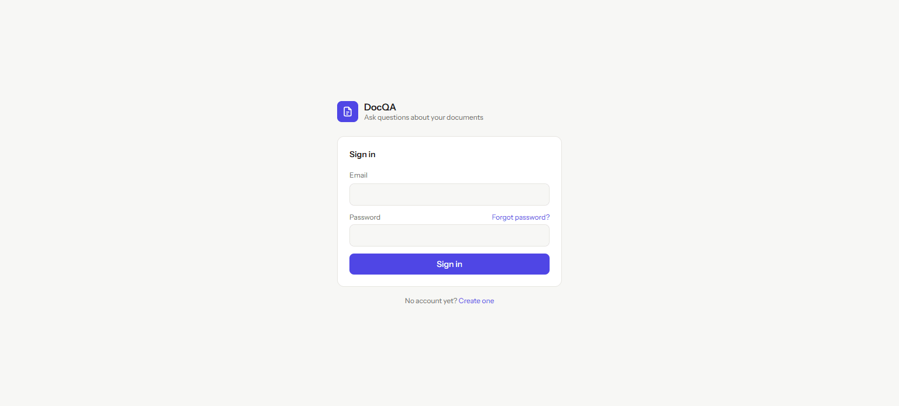

# DocQA: RAG document Q&A

[](https://github.com/GodfreysDragon/rag-doc-qa/actions/workflows/tests.yml)
[](LICENSE)

Upload PDFs, Word documents, Markdown or text files and ask questions about them. Answers stream back with inline citations that link to the exact passages they came from.



The retrieval pipeline is built by hand rather than with a hosted "chat with your PDF" API: text extraction, chunking, embeddings, vector + keyword search, rank fusion and prompt grounding are all in this repo.

**Stack:** Laravel 13 · PHP 8.4 · Vue 3 · Tailwind 4 · PostgreSQL + pgvector (MySQL / SQLite fallback) · Claude (Anthropic PHP SDK) · Voyage AI or Ollama embeddings

---

## How it works

```
INDEX TIME (queued job)
  upload ─► extract text per page ─► recursive chunking (≈300 tokens, 50 overlap)
         ─► embed chunks (input_type=document) ─► pgvector column + HNSW index
                                                 └► generated tsvector + GIN index

QUERY TIME (SSE stream)
  question ─► rewrite follow-ups into a standalone query (LLM, low effort)
           ─► embed query (input_type=query)
           ─► vector search (cosine, top 20) ─┐
           ─► keyword search (ts_rank, top 20)┴► Reciprocal Rank Fusion ─► top 6
           ─► grounded prompt with numbered <source> blocks
           ─► Claude streams an answer citing [n] ─► Vue renders clickable citations
```

### Design decisions

| Concern | Choice | Why |
|---|---|---|
| **Chunking** | Recursive splitter (paragraph → line → sentence → word) with overlap; chunks never cross a page | Keeps chunks semantically whole, and every chunk has one page number to cite. Overlap means a sentence on a boundary can be found from either side. |
| **What gets embedded** | `"Document: <title>\n\n<chunk>"` | A chunk that just says "the fee is 3%" is much easier to find when its vector also carries which document it came from. Only the chunk text is stored and shown. |
| **Asymmetric embeddings** | Separate `embedDocuments()` / `embedQuery()` | Retrieval models (Voyage `input_type`, nomic `search_query:` prefixes) encode short questions and long passages differently. |
| **Normalisation** | Every vector is L2-normalised before storage | Cosine similarity becomes a dot product, which the PHP fallback relies on. |
| **Vector index** | pgvector HNSW with `vector_cosine_ops` | Approximate nearest-neighbour search in SQL, so queries don't scan the whole table. |
| **Hybrid search** | Dense + full-text, merged with RRF (k=60) | Embeddings blur exact tokens (SKUs, names, acronyms) and keyword search catches them. RRF only uses ranks, so cosine scores and `ts_rank` never need calibrating against each other. |
| **Query rewriting** | Only when there's history | "What about the second one?" embeds badly on its own, so it's rewritten into a standalone query first. The first turn skips that LLM call. |
| **Grounding** | Sources in tagged blocks with ids; the system prompt requires `[n]` citations, a plain "not in the documents" when the sources don't cover it, and treats source text as data | Cuts down on hallucination and prompt injection from uploaded files, and makes every claim checkable in the UI. |
| **Citation highlighting** | Clicking `[n]` matches the claim before it against the sentences of source `n` (shared terms, numbers weighted double) and highlights the best match | A citation points at a whole ~300-token chunk; this narrows it to the sentence a reader actually needs to check. Done client-side, so it costs no extra LLM call. |
| **No-context short-circuit** | If nothing is retrieved, a fixed reply is returned without calling the LLM | Saves cost and avoids answers made up from general knowledge. |
| **History** | Only conversation text is sent back, never old sources; it's normalised to alternating turns | Each turn retrieves fresh sources, and the request is always valid for the Messages API. |
| **Ingestion** | Queued, unique, idempotent job (chunks replaced in one transaction); bad files fail permanently instead of retrying | Uploads return instantly, and retries never leave duplicate chunks behind. |
| **Dedup** | SHA-256 of the upload | Uploading the same file twice returns the existing document. |
| **LLM safety** | `fallbacks: "default"` server-side fallback, handling of `refusal` stop reasons, and a `reset` event if a fallback takes over mid-stream | A classifier decline is retried on another model rather than shown to the user as an empty answer. |

### Swappable components

Everything sits behind small interfaces in [`app/Services/Rag`](app/Services/Rag) and is wired up in [`AppServiceProvider`](app/Providers/AppServiceProvider.php):

- `EmbeddingProvider`: `VoyageEmbeddingProvider`, `OllamaEmbeddingProvider`, and `HashEmbeddingProvider`, an offline feature-hashing baseline. It's lexical only, so it makes a good control to compare real embeddings against, and it lets the app and tests run without keys.
- `VectorStore`: `PgvectorStore`, which does everything in SQL, and `DatabaseVectorStore`, which stores JSON embeddings and does an exact brute-force cosine scan in PHP on MySQL/SQLite.
- `ChatModel`: `ClaudeChatModel`, plus a `FakeChatModel` used in tests.

---

## Getting started

### 1. Install

```bash
composer install
cp .env.example .env
php artisan key:generate
npm install
```

### 2. Pick a database

**PostgreSQL + pgvector (recommended)**

```bash
docker compose up -d          # pgvector/pgvector:pg17 on :5432
```

Then in `.env`, uncomment the `DB_*` pgsql block.

**Or SQLite (zero setup)**: the default `.env` works as-is with the PHP fallback store.

```bash
php artisan migrate
```

### 3. Configure models

```dotenv
ANTHROPIC_API_KEY=sk-ant-...

# Hosted embeddings
EMBEDDING_PROVIDER=voyage
VOYAGE_API_KEY=pa-...
EMBEDDING_DIMENSIONS=1024

# …or local & free (ollama pull nomic-embed-text)
# EMBEDDING_PROVIDER=ollama
# EMBEDDING_DIMENSIONS=768

# …or offline lexical baseline, no key needed
# EMBEDDING_PROVIDER=hash
```

> The embedding dimension is part of the pgvector column type. If you change the provider, model or dimension, run `php artisan migrate:fresh` and re-upload, or keep your data and run `php artisan rag:reindex`, which re-chunks and re-embeds every document.

### 4. Run

```bash
composer run dev     # web server + queue worker + Vite
```

Open http://localhost:8000. Uploads are processed by the queue worker, so it has to be running.

---

## API

| Method | Endpoint | Description |
|---|---|---|
| `GET` | `/api/v1/documents` | List documents with status (`pending` → `processing` → `ready` / `failed`) |
| `POST` | `/api/v1/documents` | Upload (`multipart/form-data`, field `file`, optional `title`) |
| `GET` | `/api/v1/documents/{id}` | Show one document |
| `POST` | `/api/v1/documents/{id}/reprocess` | Re-run ingestion |
| `DELETE` | `/api/v1/documents/{id}` | Delete the document, its file and its chunks |
| `POST` | `/api/v1/chat` | Ask a question; responds with `text/event-stream` |

`POST /api/v1/chat` body:

```json
{
  "question": "What's the refund window?",
  "history": [{ "role": "user", "content": "…" }, { "role": "assistant", "content": "…" }],
  "document_ids": [1, 3]
}
```

The stream emits `query` (the search query actually used) → `sources` (ranked chunks with similarity / keyword scores) → many `text` deltas → `done` (stop reason, model, token usage), or an `error` event.

---

## Commands

```bash
php artisan rag:reindex            # re-chunk + re-embed everything
php artisan rag:reindex --stale    # only documents embedded with a different model
php artisan rag:reindex --queue    # dispatch to the queue instead of running inline
php artisan test                   # 37 tests, no network calls
```

## Configuration reference

All tunables are in [`config/rag.php`](config/rag.php): chunk size and overlap, `top_k`, candidate pool size, hybrid on/off, the RRF constant, minimum similarity, query rewriting, history length, model and effort.

## Limitations / next steps

- **Scanned PDFs** have no text layer. They fail with a clear message; adding OCR (e.g. Tesseract) at the extraction step would fix that.
- **No auth**: this is a single-user demo. For multi-tenant use, add a `user_id` to documents and scope every query by it.
- **Re-ranking**: a cross-encoder re-ranker (e.g. Voyage `rerank-2.5`) over the fused top-20 would sharpen precision further.
- **Evaluation**: a small golden set of question → expected-chunk pairs would let you measure recall@k as chunking and retrieval settings change.
- **Filtered HNSW**: when scoping to a few documents on a large corpus, enable pgvector ≥ 0.8 iterative scans (`SET hnsw.iterative_scan = relaxed_order`).

## License

[MIT](LICENSE)
